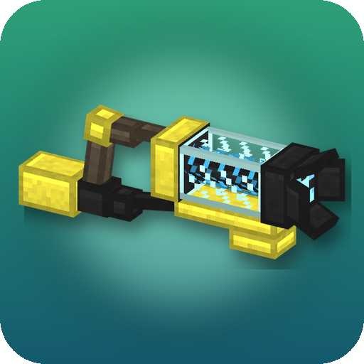

<p align="center">
  
</p>

<h1 align="center">Rancher's Vacpack</h1>

<p align="center">
  <b>A Slime Rancher inspired vacuum gun</b> - suck up items and small mobs, carry them in a tank and shoot them back out, or blast everything away with a pulse of air.
</p>

<p align="center">
  <a href="https://www.curseforge.com/minecraft/mc-mods/ranchers-vacpack"></a>
  <a href="https://www.minecraft.net"></a>
  <a href="https://neoforged.net"></a>
  <a href="https://www.curseforge.com/minecraft/mc-mods/geckolib"></a>
  <a href="LICENSE"></a>
</p>

<p align="center">
  <a href="https://www.youtube.com/watch?v=977JtGoXSZg"></a>
</p>

## Features

- 🌀 **Vacuum** - hold *Use* to suck in items and small mobs along a glowing air vortex, at full walking speed.
- 🎒 **Tank** - 4 slots of one item kind (up to 64) or one mob kind (up to 10); mobs keep their name, health, gear and
  owner; spinning 3D models in the HUD.
- 🎯 **Shoot** - *Attack* launches the selected slot, hold for auto-fire; shots are ragdolls that bounce, roll and get
  back up.
- 🌱 **Special shots** - bone meal grows plants, a fire charge sets things alight, a snowball freezes water and puts
  out fires.
- 🥕 **Feeding by shot** - shoot wheat at cows, carrots at pigs, seeds at chickens: grown-ups fall in love, babies
  grow up faster, hurt pets heal. Soft shots like wheat, seeds and wool never hurt anyone.
- 🐄 **Air stream** - mobs too big for the tank float in front of the nozzle and follow your aim.
- 💥 **Pulse Wave** - an empty slot fires a blast of air that throws mobs back and deflects projectiles; aim at the
  ground for a rocket jump.
- 🍓 **Harvesting** - vacuum ripe sweet berries and glow berries off their plants.
- 💗 **Creative Vacpack** - bottomless slots, no shot delay, vacuums any mob except bosses.

**Vacuumable mobs:** babies of any kind, small slimes and magma cubes, chickens, rabbits, pigs, cats, ocelots, foxes,
wolves, parrots, frogs, tadpoles, bees, allays, axolotls, squids, dolphins, fish, armadillos, bats, vexes, phantoms,
cave spiders, silverfish and endermites. Bosses, leashed mobs, riders and other players' pets are safe.

## Controls

| Action | Default |
|---|---|
| Vacuum / hold a mob | Hold *Use* (right click) |
| Shoot / launch held mob / pulse wave | *Attack* (left click), hold for auto-fire |
| Next tank slot | `R` or *Sneak* + *Scroll* |
| Use blocks (chests, doors) while holding the vacpack | *Sneak* + *Use* |

## Crafting

| | | |
|:---:|:---:|:---:|
| Iron Ingot | Hopper | Iron Ingot |
| Slime Ball | Breeze Rod | Slime Ball |
| Iron Ingot | Redstone | Iron Ingot |

The recipe is unlocked as soon as you pick up a Breeze Rod. In creative mode the vacpack and the Creative Vacpack are in
the **Pocky Mods** and **Tools & Utilities** tabs.

## Configuration

Server config (`serverconfig/vacpack-server.toml` of the world, also editable from the in-game mod list):

| Section | Options |
|---|---|
| `vacuum` | range (14), cone angle (30°), pull strength, capture distance, vacuum items / mobs / babies, max mob size, berry harvesting, holding mobs in the air stream and the max held size |
| `tank` | slot count (4), items per slot (64), mobs per slot (10) |
| `shooting` | shot speed, cooldown, damage of shot items, special shots (bone meal, fire charge, snowball), feeding by shot |
| `pulseWave` | enabled, range, strength, cooldown, wind burst (rocket jump) |

Data pack tags: `#vacpack:vacuumable` (entity types that can be vacuumed) and `#vacpack:not_vacuumable` (items that
are ignored).

## Installation

1. Install [NeoForge](https://neoforged.net) for Minecraft 1.21.1.
2. Put [GeckoLib](https://www.curseforge.com/minecraft/mc-mods/geckolib) and this mod into the `mods` folder.

The mod is needed on both the client and the server.

## Building

```sh
./gradlew build
```

The jar is written to `build/libs/`.

## Credits

- Author: **Pocky**.
- Sound effects are built from royalty-free sources: [Kenney](https://kenney.nl)'s Sci-Fi, Impact and Interface packs
  (CC0), the OpenGameArt uploads "Air whoosh", "Swishes Sound Pack" and "100 CC0 SFX" (CC0), and the
  "Hair dryer, maximum speed" recording from [BigSoundBank](https://bigsoundbank.com).
- Inspired by Slime Rancher. This is a fan-made mod and is not affiliated with Monomi Park.

<!-- more-mods:start -->
## More mods by Pocky

**🌦️ Weather & nature**

<table>
  <tr>
    <td width="56"><a href="https://www.curseforge.com/minecraft/mc-mods/hoarfrost-snow-blizzards"></a></td>
    <td><a href="https://www.curseforge.com/minecraft/mc-mods/hoarfrost-snow-blizzards"><b>Hoarfrost: Snow & Blizzards</b></a> - seven kinds of snowfall, a living wind and soft snow on the land (<a href="https://github.com/Pocky-l/hoarfrost">source</a>)</td>
  </tr>
  <tr>
    <td width="56"><a href="https://www.curseforge.com/minecraft/mc-mods/petrichor-rain-storms"></a></td>
    <td><a href="https://www.curseforge.com/minecraft/mc-mods/petrichor-rain-storms"><b>Petrichor: Rain & Storms</b></a> - realistic rain, puddles, drips and branching lightning (<a href="https://github.com/Pocky-l/petrichor">source</a>)</td>
  </tr>
  <tr>
    <td width="56"><a href="https://www.curseforge.com/minecraft/mc-mods/rustling-leaves"></a></td>
    <td><a href="https://www.curseforge.com/minecraft/mc-mods/rustling-leaves"><b>Rustling Leaves</b></a> - falling leaves and leaf piles you can wade through, rake and blow away (<a href="https://github.com/Pocky-l/rustling-leaves">source</a>)</td>
  </tr>
</table>

**💡 Light**

<table>
  <tr>
    <td width="56"><a href="https://www.curseforge.com/minecraft/mc-mods/lumen-rigs"></a></td>
    <td><a href="https://www.curseforge.com/minecraft/mc-mods/lumen-rigs"><b>Lumen Rigs</b></a> - aimable spotlights and floodlights with colored light and visible beams (<a href="https://github.com/Pocky-l/lumen-rigs">source</a>)</td>
  </tr>
  <tr>
    <td width="56"><a href="https://www.curseforge.com/minecraft/mc-mods/neon-glowsticks"></a></td>
    <td><a href="https://www.curseforge.com/minecraft/mc-mods/neon-glowsticks"><b>Neon Glowsticks</b></a> - throwable glowsticks that bounce, roll and light up the dark (<a href="https://github.com/Pocky-l/neon-glowsticks">source</a>)</td>
  </tr>
</table>

**🎨 Graphics & performance**

<table>
  <tr>
    <td width="56"><a href="https://www.curseforge.com/minecraft/mc-mods/turbo-for-distant-horizons"></a></td>
    <td><a href="https://www.curseforge.com/minecraft/mc-mods/turbo-for-distant-horizons"><b>Turbo for Distant Horizons</b></a> - Distant Horizons terrain generated several times faster (<a href="https://github.com/Pocky-l/dhturbo">source</a>)</td>
  </tr>
  <tr>
    <td width="56"><a href="https://www.curseforge.com/minecraft/mc-mods/pocky-shaders"></a></td>
    <td><a href="https://www.curseforge.com/minecraft/mc-mods/pocky-shaders"><b>Pocky Shaders</b></a> - a cosy, natural shader pack that sets itself up (<a href="https://github.com/Pocky-l/pocky-shaders">source</a>)</td>
  </tr>
</table>

**⚔️ Gear & gameplay**

<table>
  <tr>
    <td width="56"><a href="https://www.curseforge.com/minecraft/mc-mods/holy-staff"></a></td>
    <td><a href="https://www.curseforge.com/minecraft/mc-mods/holy-staff"><b>Holy Staff</b></a> - a healing staff with three skills and flying heal numbers (<a href="https://github.com/Pocky-l/holy-staff">source</a>)</td>
  </tr>
</table>

**⚡ Tech & energy**

<table>
  <tr>
    <td width="56"><a href="https://www.curseforge.com/minecraft/mc-mods/mekanism-advancedgenerators"></a></td>
    <td><a href="https://www.curseforge.com/minecraft/mc-mods/mekanism-advancedgenerators"><b>Mekanism Advanced Generators</b></a> - nine tiers of solar panels, big solar generators, cubes and cables for Mekanism (<a href="https://github.com/Pocky-l/Mekanism-MoreSolarPanels">source</a>)</td>
  </tr>
</table>

**🛠️ Server tools**

<table>
  <tr>
    <td width="56"><a href="https://www.curseforge.com/minecraft/mc-mods/inventory-backups"></a></td>
    <td><a href="https://www.curseforge.com/minecraft/mc-mods/inventory-backups"><b>Inventory Backups</b></a> - inventory and ender chest backups with one-click restore for admins (<a href="https://github.com/Pocky-l/inventory-backups">source</a>)</td>
  </tr>
</table>

<!-- more-mods:end -->

## License

[MIT](LICENSE)
